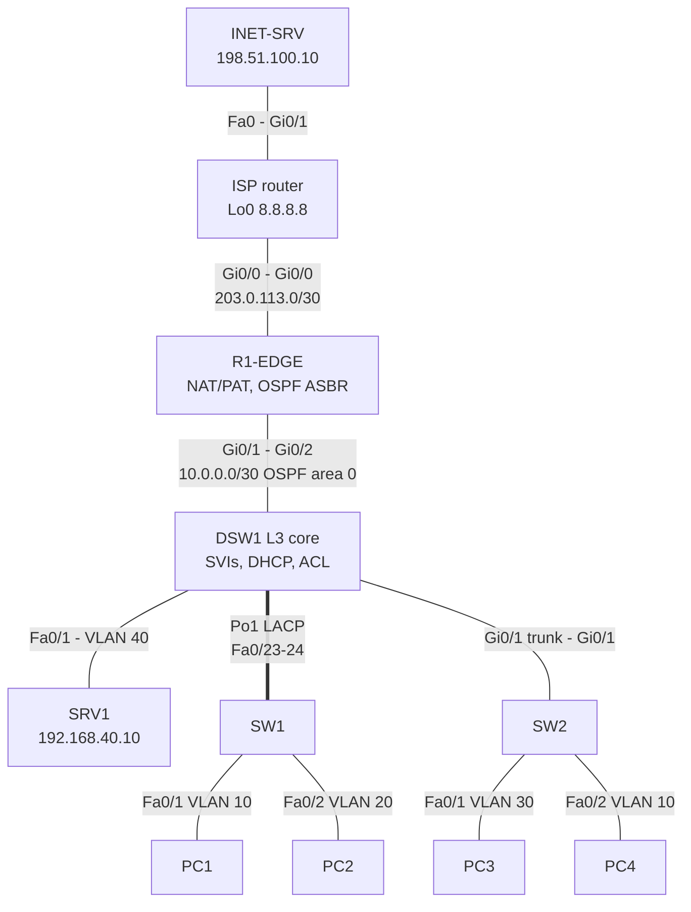
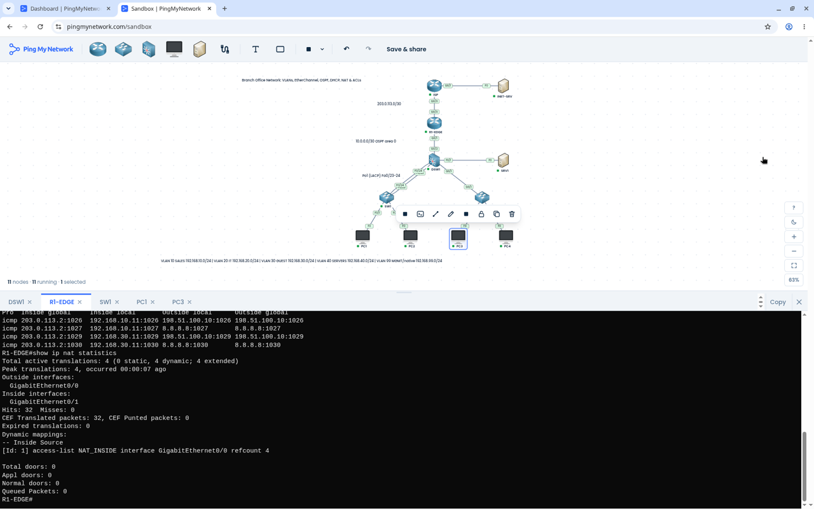

# Branch Office Network: VLANs, EtherChannel, OSPF, DHCP, NAT & ACLs

A CCNA-level lab for the **PingMyNetwork Sandbox**. You build a small branch office from scratch: access switches with
VLANs, port security and an LACP EtherChannel, a Layer 3 core switch for inter-VLAN routing and DHCP, OSPF to the
edge router, PAT to the Internet, and an ACL that limits the Guest network. It touches most of the CCNA 200-301 topics:
network access, IP connectivity, IP services and security fundamentals.

- **Devices:** 11 (2 × ISR4331, 1 × WS-C3560-24TS, 2 × WS-C2960-24TT-L, 4 × PC, 2 × Server)
- **Files:** `lab_starter.json` (import this to start) · `lab_solution.json` (fully configured reference) · `configs/` (solution CLI per device)
- **Level:** CCNA · **Time:** 2–3 h
- **Login on finished devices:** `admin` / `Cisc0Admin!` · enable secret `Cisc0Enable!` (lab only)

---

## 1. Topology



```
                 [INET-SRV] 198.51.100.10
                      | Fa0
                      | Gi0/1  198.51.100.1/24
                   [ ISP ]   Lo0 8.8.8.8/32
                      | Gi0/0  203.0.113.1/30
                      | Gi0/0  203.0.113.2/30   (ip nat outside)
                  [ R1-EDGE ]  Lo0 1.1.1.1
                      | Gi0/1  10.0.0.1/30      (ip nat inside)
                      | Gi0/2  10.0.0.2/30  (routed port)
   [SRV1]--Fa0/1--[  DSW1  ]  L3 core, SVIs .1, DHCP server
                   //Fa0/23-24   \ Gi0/1
            Po1 LACP //            \ 802.1Q trunk (native 99)
                [ SW1 ]          [ SW2 ]
               Fa0/1  Fa0/2      Fa0/1  Fa0/2
                |       |          |      |
              PC1     PC2        PC3    PC4
             V10     V20        V30    V10
```

## 2. Addressing and VLAN plan

| VLAN | Name | Subnet | Gateway (DSW1 SVI) | DHCP range | Members |
|---|---|---|---|---|---|
| 10 | SALES | 192.168.10.0/24 | 192.168.10.1 | .11 – .254 | PC1 (SW1 Fa0/1), PC4 (SW2 Fa0/2) |
| 20 | IT | 192.168.20.0/24 | 192.168.20.1 | .11 – .254 | PC2 (SW1 Fa0/2) |
| 30 | GUEST | 192.168.30.0/24 | 192.168.30.1 | .11 – .254 (DNS 8.8.8.8) | PC3 (SW2 Fa0/1) |
| 40 | SERVERS | 192.168.40.0/24 | 192.168.40.1 | static | SRV1 192.168.40.10 (DSW1 Fa0/1) |
| 99 | MGMT (native) | 192.168.99.0/24 | 192.168.99.1 | static | SW1 .11, SW2 .12 |
| 999 | BLACKHOLE | none | none | none | all unused ports (shut down) |

| Device | Interface | Address | Notes |
|---|---|---|---|
| ISP | Gi0/0 | 203.0.113.1/30 | link to customer (pre-configured) |
| ISP | Gi0/1 | 198.51.100.1/24 | Internet server LAN |
| ISP | Lo0 | 8.8.8.8/32 | "public DNS" target for ping tests |
| INET-SRV | Fa0 | 198.51.100.10/24, gw .1 | Internet web server (pre-configured) |
| R1-EDGE | Gi0/0 | 203.0.113.2/30 | NAT outside |
| R1-EDGE | Gi0/1 | 10.0.0.1/30 | NAT inside, OSPF area 0 |
| R1-EDGE | Lo0 | 1.1.1.1/32 | OSPF router ID |
| DSW1 | Gi0/2 (routed) | 10.0.0.2/30 | OSPF area 0, router ID 2.2.2.2 |
| DSW1 | Vlan10/20/30/40/99 | 192.168.x.1/24 | default gateways |
| SW1 / SW2 | Vlan99 | 192.168.99.11 / .12 | default gateway 192.168.99.1 |
| SRV1 | Fa0 | 192.168.40.10/24, gw .1 | internal server (pre-configured) |
| PC1–PC4 | Fa0 | DHCP | set to DHCP in the starter file |

## 3. Starting point
Import `lab_starter.json` (Save & share → Import JSON). Already done for you:
- All 11 devices are cabled and named. Hostnames follow the device names.
- **ISP** and **INET-SRV** play the Internet and are fully configured. Don't change them. The ISP has **no route** to your
  192.168.0.0/16 networks, so traffic only comes back if your NAT works.
- **SRV1** has its static IP. **PC1–PC4** are set to DHCP and will get an address once your DHCP server works.
- R1-EDGE, DSW1, SW1 and SW2 have a blank configuration. Everything below is your job.

## 4. Objectives
1. Segment the LAN into VLANs and carry them over 802.1Q trunks with a non-default native VLAN.
2. Bundle two links into an LACP EtherChannel.
3. Route between VLANs on a Layer 3 switch (SVIs + `ip routing`).
4. Run single-area OSPF between the core and the edge router, and advertise a default route.
5. Hand out addresses with an IOS DHCP server.
6. Give the whole LAN Internet access with PAT.
7. Isolate the Guest VLAN with an extended ACL. Protect access ports with port security, PortFast and BPDU Guard.
8. Secure device management: local users, SSH only, VTY ACL, management VLAN.

## 5. Tasks (no answers here, the solution is in §6)

**Part A: Switching**
1. On DSW1, SW1 and SW2 set VTP to transparent mode. Create VLANs 10 SALES, 20 IT, 30 GUEST, 99 MGMT and 999 BLACKHOLE (plus 40 SERVERS on DSW1 only).
2. Make SW2 Gi0/1 ↔ DSW1 Gi0/1 a static 802.1Q trunk: native VLAN 99, allowed VLANs 10,20,30,99, DTP disabled. (Remember what the 3560 needs before `switchport mode trunk`.)
3. Bundle SW1 Fa0/23–24 ↔ DSW1 Fa0/23–24 into **Port-channel 1 using LACP** (both sides active). Make Po1 a trunk with the same settings as task 2.
4. Configure the access ports from the VLAN table (SW1 Fa0/1–2, SW2 Fa0/1–2, DSW1 Fa0/1) as static access ports.
5. Enable port security on those access ports: at most 2 MAC addresses, sticky learning, violation mode **restrict**. Add PortFast and BPDU Guard.
6. Put every unused port into VLAN 999 and shut it down.
7. Run Rapid PVST+ on all switches and make DSW1 the root bridge for all VLANs (priority 4096).

**Part B: Routing**
8. On DSW1 enable IP routing. Create SVIs for VLANs 10, 20, 30, 40 and 99 using the .1 addresses, and shut down Vlan1.
9. Turn DSW1 Gi0/2 into a routed port (10.0.0.2/30). Address R1-EDGE Gi0/1 (10.0.0.1/30), Gi0/0 (203.0.113.2/30) and Loopback0 (1.1.1.1/32).
10. Configure OSPF process 1, area 0, on R1-EDGE (router ID 1.1.1.1) and DSW1 (router ID 2.2.2.2). Advertise all internal subnets, keep SVIs passive, and use point-to-point network type on the /30.
11. On R1-EDGE, add a static default route to the ISP and redistribute it into OSPF so DSW1 learns `O*E2 0.0.0.0/0`.
12. Give SW1 and SW2 management addresses in VLAN 99 (.11 / .12) and a default gateway.

**Part C: IP services**
13. On DSW1, exclude .1–.10 in VLANs 10, 20 and 30 and create DHCP pools SALES, IT and GUEST (gateway = SVI, DNS 192.168.40.10, Guest DNS 8.8.8.8, domain `branch.lab`). Check that PC1–PC4 get leases.
14. On R1-EDGE, configure PAT (NAT overload) on Gi0/0 for 192.168.10.0/24 – 192.168.40.0/24 using a standard named ACL `NAT_INSIDE`.

**Part D: Security**
15. Create the extended named ACL `GUEST_POLICY` so Guest hosts can **reach the Internet** but **not** SALES, IT, SERVERS or MGMT. Apply it where it filters closest to the source.
16. On R1-EDGE, DSW1, SW1 and SW2: enable secret, local user `admin` (privilege 15), domain `branch.lab`, 2048-bit RSA keys, SSH version 2, VTY lines with SSH only and `login local`, password encryption, and a MOTD banner.
17. Allow VTY access only from IT (192.168.20.0/24) and MGMT (192.168.99.0/24) with a standard ACL `MGMT_ACCESS`.
18. Save the configuration on every device.

## 6. Solution
The complete, paste-ready config for each device is in [`configs/`](configs/). `lab_solution.json` has it saved as startup-config.
The key commands for each task are below.

**Task 1: VTP and VLANs (DSW1 shown, SW1/SW2 the same without VLAN 40)**
```
vtp mode transparent
vlan 10
 name SALES
vlan 20
 name IT
vlan 30
 name GUEST
vlan 40
 name SERVERS
vlan 99
 name MGMT
vlan 999
 name BLACKHOLE
```

**Task 2: 802.1Q trunk DSW1 Gi0/1 ↔ SW2 Gi0/1**
```
! DSW1 (3560 needs the encapsulation command first)
interface GigabitEthernet0/1
 switchport trunk encapsulation dot1q
 switchport trunk native vlan 99
 switchport trunk allowed vlan 10,20,30,99
 switchport mode trunk
 switchport nonegotiate
! SW2 (2960 only supports dot1q, no encapsulation command)
interface GigabitEthernet0/1
 switchport trunk native vlan 99
 switchport trunk allowed vlan 10,20,30,99
 switchport mode trunk
 switchport nonegotiate
```

**Task 3: LACP EtherChannel (DSW1 shown, SW1 the same without `encapsulation dot1q`)**
```
interface range FastEthernet0/23 - 24
 switchport trunk encapsulation dot1q
 switchport trunk native vlan 99
 switchport trunk allowed vlan 10,20,30,99
 switchport mode trunk
 switchport nonegotiate
 channel-group 1 mode active
 no shutdown
interface Port-channel1
 switchport trunk encapsulation dot1q
 switchport trunk native vlan 99
 switchport trunk allowed vlan 10,20,30,99
 switchport mode trunk
 switchport nonegotiate
```

**Tasks 4–5: access ports + port security (SW1 Fa0/1 shown)**
```
interface FastEthernet0/1
 description PC1 SALES
 switchport mode access
 switchport access vlan 10
 switchport port-security
 switchport port-security maximum 2
 switchport port-security violation restrict
 switchport port-security mac-address sticky
 spanning-tree portfast
 spanning-tree bpduguard enable
 no shutdown
```
SW1 Fa0/2 → VLAN 20 · SW2 Fa0/1 → VLAN 30 · SW2 Fa0/2 → VLAN 10 · DSW1 Fa0/1 → VLAN 40.

**Task 6: unused ports (SW1 shown; SW2: Fa0/3-24, Gi0/2; DSW1: Fa0/2-22)**
```
interface range FastEthernet0/3 - 22 , GigabitEthernet0/1 - 2
 switchport mode access
 switchport access vlan 999
 shutdown
```

**Task 7: STP**
```
spanning-tree mode rapid-pvst                              ! all switches
spanning-tree vlan 1,10,20,30,40,99 priority 4096          ! DSW1 only
```

**Task 8: inter-VLAN routing on DSW1**
```
ip routing
interface Vlan1
 shutdown
interface Vlan10
 ip address 192.168.10.1 255.255.255.0
 no shutdown
interface Vlan20
 ip address 192.168.20.1 255.255.255.0
 no shutdown
interface Vlan30
 ip address 192.168.30.1 255.255.255.0
 no shutdown
interface Vlan40
 ip address 192.168.40.1 255.255.255.0
 no shutdown
interface Vlan99
 ip address 192.168.99.1 255.255.255.0
 no shutdown
```

**Task 9: routed links**
```
! DSW1
interface GigabitEthernet0/2
 no switchport
 ip address 10.0.0.2 255.255.255.252
 no shutdown
! R1-EDGE
interface Loopback0
 ip address 1.1.1.1 255.255.255.255
interface GigabitEthernet0/0
 ip address 203.0.113.2 255.255.255.252
 no shutdown
interface GigabitEthernet0/1
 ip address 10.0.0.1 255.255.255.252
 no shutdown
```

**Tasks 10–11: OSPF + default route**
```
! R1-EDGE
interface GigabitEthernet0/1
 ip ospf network point-to-point
router ospf 1
 router-id 1.1.1.1
 passive-interface Loopback0
 network 1.1.1.1 0.0.0.0 area 0
 network 10.0.0.0 0.0.0.3 area 0
 default-information originate
ip route 0.0.0.0 0.0.0.0 203.0.113.1

! DSW1
interface GigabitEthernet0/2
 ip ospf network point-to-point
router ospf 1
 router-id 2.2.2.2
 passive-interface Vlan10
 passive-interface Vlan20
 passive-interface Vlan30
 passive-interface Vlan40
 passive-interface Vlan99
 network 10.0.0.0 0.0.0.3 area 0
 network 192.168.10.0 0.0.0.255 area 0
 network 192.168.20.0 0.0.0.255 area 0
 network 192.168.30.0 0.0.0.255 area 0
 network 192.168.40.0 0.0.0.255 area 0
 network 192.168.99.0 0.0.0.255 area 0
```

**Task 12: switch management (SW1 shown, SW2 = .12)**
```
interface Vlan99
 ip address 192.168.99.11 255.255.255.0
 no shutdown
ip default-gateway 192.168.99.1
```

**Task 13: DHCP on DSW1**
```
ip dhcp excluded-address 192.168.10.1 192.168.10.10
ip dhcp excluded-address 192.168.20.1 192.168.20.10
ip dhcp excluded-address 192.168.30.1 192.168.30.10
ip dhcp pool SALES
 network 192.168.10.0 255.255.255.0
 default-router 192.168.10.1
 dns-server 192.168.40.10
 domain-name branch.lab
ip dhcp pool IT
 network 192.168.20.0 255.255.255.0
 default-router 192.168.20.1
 dns-server 192.168.40.10
 domain-name branch.lab
ip dhcp pool GUEST
 network 192.168.30.0 255.255.255.0
 default-router 192.168.30.1
 dns-server 8.8.8.8
 domain-name branch.lab
```

**Task 14: PAT on R1-EDGE**
```
ip access-list standard NAT_INSIDE
 permit 192.168.10.0 0.0.0.255
 permit 192.168.20.0 0.0.0.255
 permit 192.168.30.0 0.0.0.255
 permit 192.168.40.0 0.0.0.255
interface GigabitEthernet0/1
 ip nat inside
interface GigabitEthernet0/0
 ip nat outside
ip nat inside source list NAT_INSIDE interface GigabitEthernet0/0 overload
```

**Task 15: Guest isolation on DSW1 (extended ACL, inbound on the Guest SVI = closest to the source)**
```
ip access-list extended GUEST_POLICY
 remark Guests may reach the Internet only
 deny ip 192.168.30.0 0.0.0.255 192.168.10.0 0.0.0.255
 deny ip 192.168.30.0 0.0.0.255 192.168.20.0 0.0.0.255
 deny ip 192.168.30.0 0.0.0.255 192.168.40.0 0.0.0.255
 deny ip 192.168.30.0 0.0.0.255 192.168.99.0 0.0.0.255
 permit ip any any
interface Vlan30
 ip access-group GUEST_POLICY in
```
*Why `permit ip any any`?* Every ACL ends with an implicit `deny any`. Without the permit, Guests would lose DHCP and Internet access too.

**Tasks 16–17: secure management (all four devices; switches also configure `line vty 5 15`)**
```
service password-encryption
no ip domain-lookup
ip domain-name branch.lab
enable secret Cisc0Enable!
username admin privilege 15 secret Cisc0Admin!
crypto key generate rsa general-keys modulus 2048
ip ssh version 2
banner motd #Authorized access only - Branch Office lab#
ip access-list standard MGMT_ACCESS
 permit 192.168.20.0 0.0.0.255
 permit 192.168.99.0 0.0.0.255
line con 0
 logging synchronous
line vty 0 4
 access-class MGMT_ACCESS in
 exec-timeout 10 0
 login local
 transport input ssh
```

**Task 18:** `write memory` (or `copy running-config startup-config`) on every device.

## 7. Verification

| Device | Command | Expected |
|---|---|---|
| SW1, DSW1 | `show vlan brief` | VLANs 10/20/30/99/999 (+40 on DSW1) with the right access ports |
| SW1, DSW1 | `show etherchannel summary` | `Po1(SU)` with `Fa0/23(P) Fa0/24(P)`, protocol LACP |
| DSW1, SW2 | `show interfaces trunk` | Po1 and Gi0/1 trunking, native 99, allowed 10,20,30,99 |
| DSW1 | `show spanning-tree vlan 10` | "This bridge is the root" |
| SW1 | `show port-security interface fa0/1` | Port Security Enabled, Secure-up, violation Restrict, max 2 |
| DSW1 | `show ip interface brief` | Vlan10/20/30/40/99 and Gi0/2 up/up |
| DSW1 | `show ip ospf neighbor` | 1.1.1.1 FULL (point-to-point, so no DR/BDR) |
| DSW1 | `show ip route` | `O*E2 0.0.0.0/0 via 10.0.0.1`, `O 1.1.1.1/32`, five connected /24s |
| R1-EDGE | `show ip route ospf` | 192.168.10/20/30/40/99.0/24 via 10.0.0.2 |
| DSW1 | `show ip dhcp binding` | leases for PC1–PC4 (from .11 up) |
| PC1–PC4 | `ipconfig` | address from the right pool, gateway = VLAN .1 |
| R1-EDGE | `show ip nat translations` (after pinging out) | `icmp 203.0.113.2:n 192.168.10.11:n 8.8.8.8:n …` |
| DSW1 | `show access-lists GUEST_POLICY` | match counters go up on the deny lines after the Guest ping tests |
| SW1 | `show ip ssh` / `show ssh` | SSH 2.0 enabled |

**Ping matrix** (DHCP addresses can differ, so check `ipconfig` first)

| From | To | Expected | Proves |
|---|---|---|---|
| PC1 (V10, SW1) | PC4 (V10, SW2) | ✅ success | VLAN across EtherChannel + trunk |
| PC1 (V10) | PC2 (V20) 192.168.20.x | ✅ success | inter-VLAN routing |
| PC2 (V20) | SRV1 192.168.40.10 | ✅ success | routing to server VLAN |
| PC1 | 8.8.8.8 and 198.51.100.10 | ✅ success | OSPF default route + PAT |
| PC3 (Guest) | 8.8.8.8 | ✅ success | Guest has Internet access |
| PC3 (Guest) | SRV1 192.168.40.10 | ❌ fails (unreachable/timeout) | GUEST_POLICY ACL |
| PC3 (Guest) | PC1 / PC2 / 192.168.99.11 | ❌ fails | Guest isolated from internal LAN |
| ISP | 192.168.10.11 | ❌ fails (no route) | inside addresses hidden by NAT |
| PC2 (IT) | `ssh -l admin 192.168.99.11` | ✅ login prompt | SSH + MGMT_ACCESS permit |
| PC1 (Sales) | `ssh -l admin 192.168.99.11` | ❌ refused | VTY access-class |

The first ping across a router can lose 1 packet while ARP resolves. That is normal.

## 8. Tested in the PingMyNetwork Sandbox (PMN-OS 3.0)
I imported `lab_solution.json` and checked it in the Sandbox. These results came from the emulator:
- `show etherchannel summary` on DSW1 shows `Po1(SU)`, LACP, `Fa0/23(P) Fa0/24(P)`.
- `show interfaces trunk` on SW1 shows Po1 on 802.1q, native VLAN 99, allowed VLANs 10,20,30,99.
- `show ip ospf neighbor` on DSW1 shows 1.1.1.1 FULL on Gi0/2. `show ip route` shows `O*E2 0.0.0.0/0 via 10.0.0.1`.
- `show ip dhcp binding` on DSW1 shows leases in 192.168.10.x, 192.168.20.x and 192.168.30.x.
- `show port-security` on SW1 shows Fa0/1 and Fa0/2 at max 2 and action Restrict.
- `show ip nat translations` on R1-EDGE shows ICMP translated to 203.0.113.2. `show ip nat statistics` shows ACL NAT_INSIDE with 0 misses.
- PC1 (Sales) pinged SRV1, INET-SRV and 8.8.8.8 with 4/4 replies each.
- PC3 (Guest) reached the Internet. Its ping to SRV1 got "Destination net unreachable" from 192.168.30.1, which shows the Guest ACL is blocking it.



Notes:
- Use `terminal length 0` before long `show` commands to avoid `--More--`.
- RSA keys are not stored in the startup-config. After importing `lab_solution.json`, run `crypto key generate rsa general-keys modulus 2048` again on each device before testing SSH.
- The ISR4331 ports are `GigabitEthernet0/0–0/3` in the Sandbox (a real ISR4331 uses `0/0/0–0/0/2`).
- This lab uses VLAN 99 as both the native VLAN and the management VLAN to keep it simple. In production, best practice is a separate unused native VLAN.

## 9. Files
- `lab_starter.json`: import to start (ISP/INET-SRV/SRV1 configured, PCs on DHCP, everything else blank).
- `lab_solution.json`: every device's configuration stored as startup-config (`storage.<id>.nvram.file`) plus VLAN databases.
- `configs/<device>.txt`: paste-ready CLI (`enable` → `configure terminal` → … → `write memory`). `configs/HOSTS.txt` lists the endpoint IP settings.

---
Built by Ricardo Estrada ([@OwenRick1](https://github.com/OwenRick1)) for the PingMyNetwork Sandbox Challenge.
